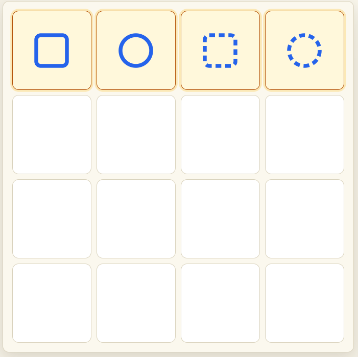
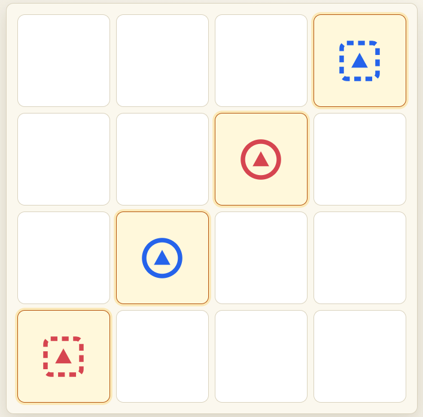

# Dictate

A free browser Quarto-style game with a twist: **you choose the piece your opponent must place**. Make four in a row share at least one trait — or, in Opposite Mode, force *them* to be the one who completes it.

No build step, no dependencies — just open it and play. Installable as an app (PWA) with offline play.





## Play it

```sh
cd Quatro
python -m http.server 8000
# open http://localhost:8000
```

or [Play Here](malcolmblakeman.github.io/Dictate)
## Modes

- **Classic** — the 10 rows, columns, and diagonals.
- **Advanced 2×2** — adds the 9 contiguous 2×2 blocks: 19 winning shapes.
- **Opposite Mode** (misère, unlocked via easter egg) — whoever completes a shape *loses*.

## AI opponent

Plays any mode and any side (Player 1, Player 2, or Both for self-play). Takes immediate wins, never donates a winning piece, blocks threats, concedes gracefully when doomed, and searches endgames exactly with alpha-beta pruning. Levels: Easy / Normal / Hard.

## Puzzles

Ten hand-checked, engine-verified puzzles in two wings of five: spot the win, find the safe donation, escape misère traps, deliver killer gifts. Wrong attempts are taken back automatically; best try-counts are saved. Beat 1–5 to unlock 6–10.

## Controls

| Key | Does |
| --- | ---- |
| Z / U | Undo |
| R | Reset (retry in puzzles) |
| E | Eval bar (chess-style, white = Player 1) |
| L | Light / dark |
| I | Info |
| Esc | Close dialogs |

## Files

| File | What |
| ---- | ---- |
| `index.html` | The whole game (board, engine, AI, puzzles) |
| `manifest.json`, `icon.svg`, `sw.js` | PWA shell: installability, icon, offline cache |
| `docs/` | Screenshots and gameplay GIF for this readme |
